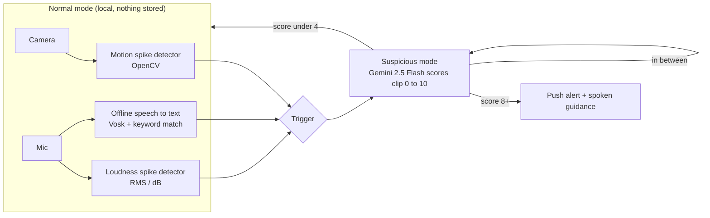

# Sixth Sense

**Privacy first AI home safety monitoring.** Built at JAMHacks 10.

[Devpost](https://devpost.com/software/sixth-sense-83jml1) · [Demo video](https://youtu.be/V6U_5K0P1Og)

Most home cameras either record everything (bad for privacy) or miss what matters. Sixth Sense stays in a cheap, fully local **normal mode** and only escalates to AI when something actually looks wrong.

## How it works



* **Normal mode never uses AI and never uploads anything.** Motion is a rolling baseline of frame differences; sound is RMS loudness against a slowly adapting baseline (so a TV or a party doesn't count as a spike); speech runs through Vosk fully offline.
* **Suspicious mode** sends one short clip to Gemini, which returns a confidence score, an analysis, and spoken instructions for the person at home.
* **Alerts** go to a React Native phone app through Expo push notifications and to a live web dashboard, with spoken guidance voiced by ElevenLabs.

## Stack

| Part | Tech |
| --- | --- |
| Detection server | Python, OpenCV, WebSockets |
| Analysis server | Node.js, Express, `ws`, Google Gemini (`@google/genai`), ElevenLabs TTS |
| Offline keywords | Vosk (Python) + Node orchestrator |
| Web dashboard | React 19, Vite, Tailwind CSS |
| Mobile app | React Native, Expo (camera, notifications, speech) |

## Repo layout

```
backend/
  server.py              camera capture + motion detection, broadcasts over WebSocket
  analyzeServer.js       /analyze endpoint, frame stream, push notification hooks
  normal_mode/           motion, audio spike and offline keyword triggers
  suspicious_mode/       Gemini analysis + decision engine (alert / keep watching / reset)
web_sense/               React dashboard (camera feed, status, alert feed)
app_sense/               Expo mobile app (home, activity, alert detail screens)
start.sh                 starts every service at once
```

## Running it

Requires Python 3, Node 20+, ffmpeg and sox, plus `GEMINI_API_KEY`, `ELEVENLABS_API_KEY` and `ELEVENLABS_VOICE_ID` in `backend/.env`.

```bash
cd backend && npm install && pip install opencv-python websockets vosk
cd ../web_sense && npm install
cd .. && ./start.sh   # update the paths in start.sh to your clone first
```
