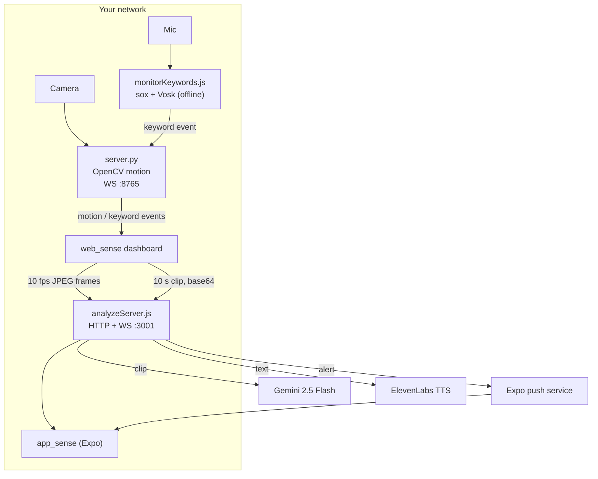

# Architecture

Sixth Sense is four cooperating processes plus two client apps. Everything runs
on the local network; the only outbound calls are to Gemini, ElevenLabs and
Expo's push service, and only after a trigger.

## Components

| Component | Path | Role |
| --- | --- | --- |
| Detection server | `backend/server.py` | Captures frames, runs the motion detector, runs a WebSocket hub on `ws://localhost:8765` that rebroadcasts every message to every client |
| Motion detector | `backend/normal_mode/motion_detector.py` | Mean absolute frame difference on 320x240 grayscale frames, compared with a rolling baseline |
| Audio spike engine | `backend/normal_mode/audioTriggerEngine.js` | RMS loudness in dB against an adaptive baseline, with sensitivity presets and a cooldown |
| Keyword listener | `backend/normal_mode/monitorKeywords.js` | Pipes mic audio through sox into `stt_vosk.py`, matches phrases, sends a `keyword` event to port 8765 |
| Analysis server | `backend/analyzeServer.js` | Express and `ws` on port 3001: frame relay, `/analyze`, text to speech, push registration |
| Suspicious mode | `backend/suspicious_mode/` | `geminiAnalyzer.js` scores a clip, `decisionEngine.js` turns the score into a decision |
| Push | `backend/services/pushNotification.js` | Sends Expo push notifications to the registered device |
| Web dashboard | `web_sense/` | React app: camera feed, status, alert feed, records the clip and calls `/analyze` |
| Phone app | `app_sense/` | Expo app: home, activity, alert detail and conflict overview screens |

## Control flow

1. **Normal mode.** The motion detector, audio spike engine and keyword listener
   run continuously and locally. Motion and keyword hits are published on the
   `:8765` hub. Nothing is stored and no AI is involved.
2. **Trigger.** The dashboard receives an event and starts suspicious mode: it
   records a 10 second clip from the browser's camera stream.
3. **Analysis.** The clip (base64) is posted to `/analyze`. The server sends it to
   Gemini 2.5 Flash with a structured JSON schema and gets back
   `confidence`, `analysis` and `spokenInstructions`.
4. **Decision.** `decisionEngine.js` applies the thresholds in
   `suspicious_mode/constants.js`:

   | Score | Decision |
   | --- | --- |
   | `>= 8` | `send_alert` |
   | `4` to `7` | `continue_analyzing` |
   | `< 4` | `return_to_normal` |

5. **Alert.** On `send_alert` the server pushes a notification through Expo and
   the dashboard fetches `/audio/latest` to play the spoken guidance.

## Data and state

- No database. The server keeps only the **latest camera frame**, the **latest
  generated audio** and **one push token**, all in memory. They are lost on
  restart.
- Clips exist in the request body and in browser memory while being analysed.
  They are not written to disk by the server.

## Key design choices

- **Two stages.** Cheap local detectors have high recall; the model supplies
  judgement. This keeps cost, latency and data exposure low.
- **Python Vosk bridge.** The Node `vosk` package needs `ffi-napi`, which does
  not compile on current macOS toolchains, so speech to text runs as a Python
  subprocess.
- **WebSocket hub.** One tiny relay lets the Python and Node processes and the
  browser share events without a message broker.

## Known rough edges

- Ports and a LAN IP are hardcoded in `web_sense` and `app_sense`.
- `start.sh` contains absolute paths from the original author's machine.
- `pushNotification.js` expects confidence on a 0 to 1 scale and an
  `analysis.summary` field, while the analyzer returns a 0 to 10 integer and a
  plain string. See [../ROADMAP.md](../ROADMAP.md).
